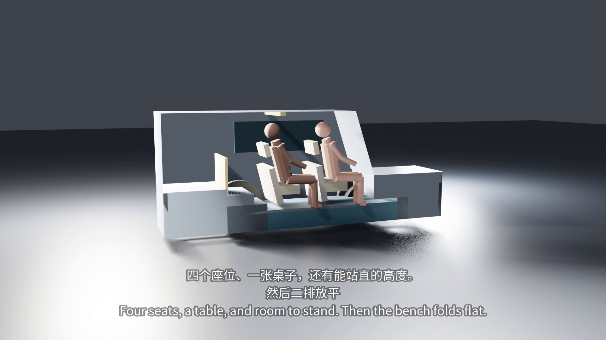

**English** | [简体中文](README.zh-CN.md)


# my car

**Small outside, big inside** — a shape-shifting camper car for the commuter, the cinema, the campsite and the bed in between.

**A 4.46 m car that lets a 1.75 m person sleep flat and stand upright inside, using purely mechanical transformation — one motor, for the pop-top roof, and nothing else.** It exists because a daily car spends most of its life parked: instead of making it bigger, this project changes the interior over time, and proves every claim with a parametric blueprint whose drawing and checks share one geometry.



*Frame from the 99.5 s intro film (11 shots): the near half of the shell is cut away so the cabin, the people and the bed read in one view.*

## Quick start

No install, no dependencies, no build step — the whole tool is one HTML file:

```bash
git clone https://github.com/ZisIsNotZis/mycar.git
cd mycar
xdg-open 蓝图-v17.html        # macOS: open 蓝图-v17.html
```

Left: a side-section drawing. Right: 37 parameter sliders, mechanism switches, live checks and derived dimensions. Pick a preset (`常规` / `对坐` / `大床` / `大床观影` / `小床` / `小床观影` / `升顶` / `升顶站立`), drag a person's joint, or hit `落下 / 稳定` to drop the ragdoll and let physics settle the pose.

## What it can do now

- **One geometry, two consumers.** `derive()` produces the parts; `draw()` renders them and `checks()` validates the same objects — there is no second copy of the math. This is enforced as a project rule after an earlier engine accumulated 30+ geometry/validation mismatches.
- **Three-layer zero-coordinate chains.** Chassis (layer A), cabin (layer B) and pop-top (layer C) are each a head-to-tail chain, so the car length `L` is derived, and parts cannot overlap by construction.
- **Mechanism states are switches, not parameters.** Front-seat rotation, rear-bench fold, flip-panel angle and pop-top height combine into 8 presets with 760 ms eased transitions.
- **5 layout snapshots** load a full parameter set — the output of the size-reduction experiment (`现状 4870`, `紧凑 4460`, `更紧 4350`, `无下限 4080`, plus the pre-rule car that fails the crash-structure check).
- **Physical people, not drawn poses.** A 6-particle PBD ragdoll (ankle, knee, hip, shoulder, head, toe) settles under gravity against hard bodies and soft cushions; joints can be dragged. Checks and physics share one collision kernel.
- **C1–C21 hard checks**, covering chain integrity, height stacking, bed continuity, leg-rest contact, bed length, standing headroom, crash-structure rows, knee clearance, skeleton consistency and battery volume.
- **Size-reduction optimizer.** `scripts/shrink.mjs` searches the parameter domain for the shortest car that passes all eight presets, and reports which check blocks each further 10 mm.
- **3D out.** `scripts/export-glb17.mjs` extrudes the derived geometry to glTF; Blender scripts render stills and a 99.5 s narrated film with bilingual burned-in subtitles.

## Architecture

```
蓝图-v17.html            current engine: single file, no dependencies (side section + physics)
蓝图-*.html              archived v2–v16 iterations, kept for archaeology, never edited
scripts/                 headless verification, optimizer, GLB export, Blender stills and film
docs/design/             design SSOT (Chinese): vehicle design, decisions, tool spec, film script
docs/plan/               open verification work
.scratch/                work records and evidence: renders, film frames, subtitles, audio
assets/logo.svg
```

The HTML page is the product and the source of truth. It exposes `window.MY` (`derive`, `checks`, `draw`, `settle`, `PRESETS`, `LAYOUTS`, …) so headless scripts can drive it: Playwright opens the file, calls the same functions the UI calls, exports measurements or glTF, and Blender consumes the baked frames. Nothing re-implements the geometry outside the page.

- `docs/design/整车设计.md` — vehicle design SSOT: envelope, dimensions, mechanism states, storage, criteria.
- `docs/design/结构决策.md` — decided boundaries and the reason for each (`D1`–`D68`), including rejected branches.
- `docs/design/蓝图工具.md` — engine conventions and the headless verification recipe.
- `docs/design/介绍视频脚本.md` — the film: 11 shots, narration and toolchain.

## Develop

Requirements: Node 24 and a Chromium reachable through Playwright. The scripts import Playwright by absolute path (currently `/home/z/vibe/vibeos/node_modules/playwright/index.mjs`); point that import at your own install. Blender 4.x is needed only for rendering.

```bash
# shortest-car search (deterministic; all eight presets must stay green)
node scripts/shrink.mjs

# derived geometry → glTF
node scripts/export-glb17.mjs /tmp/mycar-glb17/4460.glb --layout=紧凑 --mode=大床

# stills: GLB → Blender (Cycles) → contact sheet
blender -b -P scripts/blender-render.py -- /tmp/mycar-glb /tmp/mycar-glb/png 2 1000
python3 scripts/contact-sheet.py /tmp/mycar-glb/png /tmp/mycar-glb/sheet.png

# film: bake frames → Blender render → narration/music/SFX → subtitles
node scripts/bake-frames17.mjs /tmp/mycar-film/frames.json
bash scripts/film-finish.sh
```

The verification gate is the in-page check list: open the page, walk all eight presets, require every hard check to be green and the console to stay clean — then **look at the rendered image**, because numbers alone are not accepted evidence in this project. The exact headless recipe is in `docs/design/蓝图工具.md`.

`scripts/render.mjs`, `check.mjs`, `audit.mjs` and `bake-frames.mjs` target the older v13 `MY.build/M` interface and are **not** valid gates for v17.

## Contributing

Read [CONTRIBUTING.md](CONTRIBUTING.md) first. Design changes need the owner's sign-off; code and tooling fixes are welcome with evidence (a render, a measurement, a failing check).

## Roadmap

**Implemented**

- v17 engine: zero-coordinate chains, derived dimensions, mechanism presets, layout snapshots.
- PBD ragdoll with drag and drop, shared by drawing, checks and 3D export.
- C1–C21 checks, including crash-structure rows and knee clearance (the rules that stopped the "cheat the limit" shortcuts).
- Deterministic size-reduction experiment and its published layouts (4460 compact / 4350 tighter / 4080 without interior floors).
- glTF export, Blender stills, and the 99.5 s intro film with narration and bilingual subtitles.

**Planned**

- Real body surfaces and wheel arches; the current model is boxes and a skeleton.
- Better seat geometry (currently boards with a cushion) and depth of field in the film.
- Front and top views — the side section cannot express width, overhead cabinets or screens.
- 3D engineering drawings, a prototype and supply chain: not started.

Future vision: the same single-file engine grows into the dimensioning authority for a real build — every part, every check and every camera move reading one geometry, so a change in the design shows up in the drawing, the validation and the film at once.

## License

[GNU Affero General Public License v3.0](LICENSE.md) — Copyright © ZisIsNotZis.
